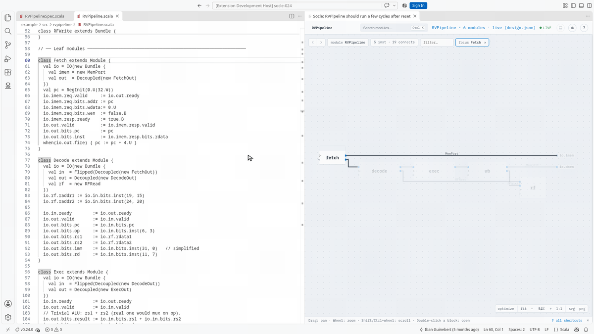
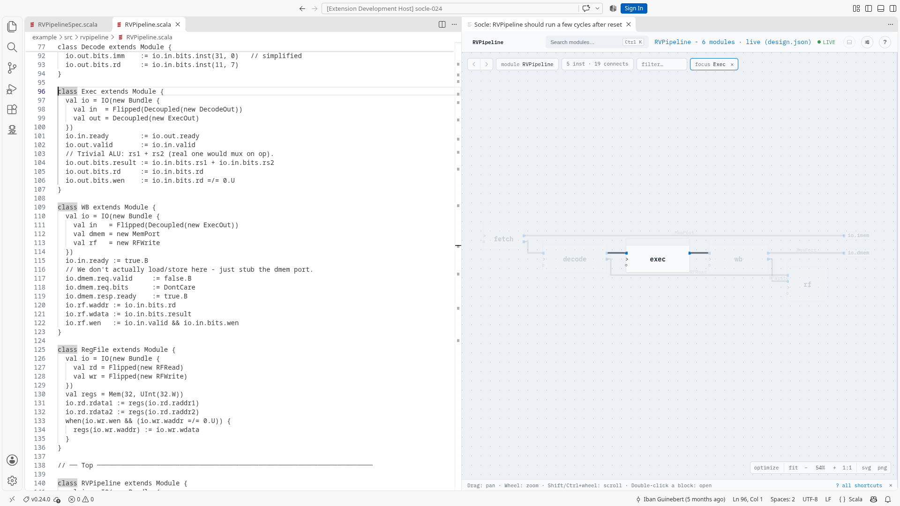
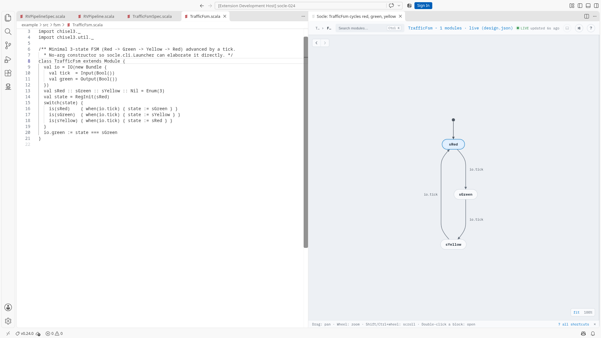
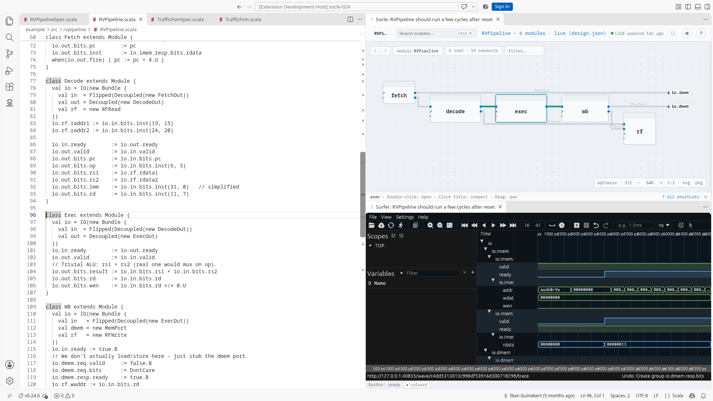

# Socle for VS Code

Chisel IDE support for Scala files: a "View design" lens above ChiselSim tests opens the elaborated
design in a panel beside the editor, and the schematic follows your cursor. The Socle side panel
(activity bar) lists the workspace's tests (View design and Simulate on each), the design's instance
hierarchy, its classes and the details of the selection. The Classes view groups the modules by
Scala class, then by the constructor arguments they were built with (same arguments, one row), then
lists their instances: a click shows the instance in the schematic. It needs the language server of
Socle 0.30.0 or later.

<picture>
  <source media="(prefers-color-scheme: dark)" srcset="https://raw.githubusercontent.com/socless/socle-vscode/main/docs/media/hero-dark.gif">
  
</picture>

## Requirements

- Java 21 or newer (set `socle.javaPath` if `java` on your PATH is older).
- A Mill project that contains the Chisel design.
- ChiselSim tests: the lens runs the test and captures the design it elaborates.

<picture>
  <source media="(prefers-color-scheme: dark)" srcset="https://raw.githubusercontent.com/socless/socle-vscode/main/docs/media/schematic-dark.png">
  
</picture>
<picture>
  <source media="(prefers-color-scheme: dark)" srcset="https://raw.githubusercontent.com/socless/socle-vscode/main/docs/media/fsm-dark.png">
  
</picture>
<picture>
  <source media="(prefers-color-scheme: dark)" srcset="https://raw.githubusercontent.com/socless/socle-vscode/main/docs/media/waves-dark.png">
  
</picture>

The schematic follows your cursor · a state machine's diagram · waveforms that follow the selection

## Settings

- `socle.javaPath`: the Java executable used to run the language server.
- `socle.serverJar`: use a custom language server jar instead of the bundled one.

Check the extension's Settings page for the full list and defaults.

## Third-party software

The bundled language server ships [Surfer](https://surfer-project.org/) v0.7.0,
built to WebAssembly, for the panel's Waveform tab. Surfer is a separate work
licensed under the EUPL-1.2; its licence text and source pointer ship beside it
in the server jar (`surfer/LICENSE-EUPL-1.2.txt`, `surfer/SOURCE.md`).

## Install

Search for "Socle" in the Extensions view, or install `socless.socle`:

- VS Code: from the [Visual Studio Marketplace](https://marketplace.visualstudio.com/items?itemName=socless.socle).
- VSCodium and other editors using Open VSX: from [Open VSX](https://open-vsx.org/extension/socless/socle).

Each release's vsix is also on the
[releases page](https://github.com/socless/socle-vscode/releases): install it with
`code --install-extension socle-<version>.vsix` or "Extensions: Install from VSIX..." in
VS Code. Each release bundles the language server of one Socle release (named in its notes).
To build it yourself, see [DEVELOPING.md](DEVELOPING.md).

## License

Copyright (C) 2026 Iban Guinebert. Licensed under the GNU AGPL-3.0-only, like Socle: see the
LICENSE file and Socle's [LICENSING.md](https://github.com/socless/socle/blob/main/LICENSING.md),
which also covers the commercial licence. The bundled language server carries its own notices
(`socle-legal/` in the jar), and the extension ships `vscode-languageclient` (MIT).
